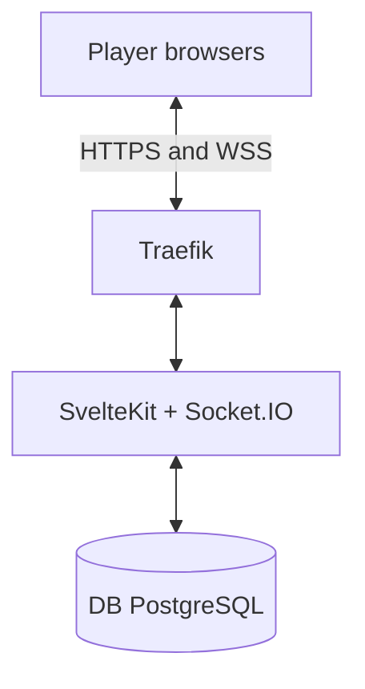

# Traffic Lights Game

SvelteKit and Socket.IO share one Node.js service. PostgreSQL runs on a separate Docker network from Traefik; only the app connects to both networks.

## Architecture



The game engine (`kit/game.ts`) handles rules and returns a player-specific view used by both HTTP and Socket.IO. The repository persists game state in PostgreSQL. Socket presence and the per-game command queue live in the app process, so the current deployment runs **one app replica**.

## Production

Configure `.env` using `.env.example` and generate a strong `POSTGRES_PASSWORD`; there is no production default. `DATABASE_URL` must point to `tlg-db` and use a dedicated database role with SELECT, INSERT and UPDATE on the game tables and USAGE on the answer ID sequence. On an empty database, apply `kit/schema.sql` as the database owner and grant these permissions before starting the app. Existing databases do not need reinitialization.

```sh
docker compose -f compose.prod.yml up -d db
docker compose -f compose.prod.yml up -d --build --wait app
```

The external Traefik network must already exist. The `postgres19_data` volume stores all game data.

## Local development

Use a separate Compose project and a local `.env`. For a disposable local database, set `DATABASE_URL` to use the same credentials as `POSTGRES_USER` and `POSTGRES_PASSWORD`. The development override initializes the schema on first startup.

```sh
make up
```

Open `http://localhost:3000`. Run `make test` with Node.js 26 for the game logic tests, or `npm --prefix kit run check` after `npm ci --prefix kit` to check Svelte and TypeScript. `make down` stops the local stack without deleting data.

### Browser tests

With the local Compose stack running, install Chromium and run Playwright:

```sh
npm ci --prefix kit
(cd kit && npx playwright install chromium)
make playwright
```

The test creates a game in the local database. The default target is `http://localhost:3000`; use `PLAYWRIGHT_BASE_URL` only for an isolated test deployment.
